# Proxmox Home Lab – Teil 2: Infrastructure as Code (IaC) mit Terraform & Ansible

[](https://www.terraform.io/)
[](https://www.ansible.com/)
[](https://www.proxmox.com/)
[](LICENSE)

Dieses Repository repräsentiert **Teil 2** einer strukturierten Homelab-Serie und implementiert eine enterprise-orientierte, modulare Infrastructure-as-Code (IaC) Pipeline für eine lokale **Proxmox VE** Umgebung. 

Das Projekt automatisiert den kompletten Lebenszyklus von virtuellen Maschinen (VMs) und Linux-Containern (LXCs) – beginnend bei der Bereitstellung über standardisierte Cloud-Init-Basistemplates bis hin zur automatisierten Systemkonfiguration und Härtung.

## 🗺️ Projekt-Übersicht & Architektur

Das folgende Schaubild veranschaulicht die gesamte Architektur und den Workflow des Projekts – von der Steuerung via Windows/WSL bis zur Bereitstellung im Proxmox VE Home Lab:

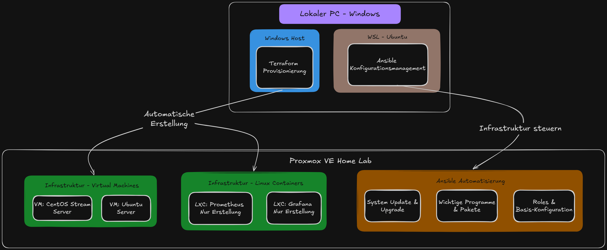

### 📌 Projekt-Roadmap
* **Teil 2: Infrastructure as Code mit Terraform & Ansible** *(Aktuelles Projekt)*
* **Teil 3: Zentrales Monitoring mit Prometheus & Grafana** *(Folgeprojekt)*

## 🏗️ Architektur & Repository-Struktur

```text
Infrastructure as Code mit Terraform & Ansible
├── .gitignore
├── images/
│   ├── project_mindmap.png # Architektur-Mindmap & Roadmap
│   ├── terraform/          # 19 optimierte Terraform- & Proxmox-Screenshots (alle .png)
│   └── ansible/            # 3 Ansible- & WSL-Verifikations-Screenshots (alle .png)
├── terraform/
│   ├── modules/
│   │   ├── proxmox_vm/     # Modul für Ubuntu/CentOS VMs
│   │   └── proxmox_lxc/    # Modul für Prometheus/Grafana LXCs
│   ├── main.tf             # Hauptorchestrierung der Terraform-Module
│   ├── provider.tf         # bpg/proxmox Provider-Konfiguration
│   ├── variables.tf        # Globale Projektvariablen
│   ├── outputs.tf          # IP-Adressen und Zugriffs-Outputs
│   └── terraform.tfvars.example # Sicheres Template für Variablen
└── ansible/
    ├── ansible.cfg         # WSL-optimierte Konfiguration & Pfadrechte
    ├── inventory.ini       # Statisches Inventory der Nodes
    ├── bootstrap.yml       # Initiale Vorbereitung und User-Provisioning
    ├── site.yml            # Haupt-Playbook für Konfiguration & Hardening
    ├── group_vars/         # Host- und Gruppenspezifische Variablen
    └── roles/
        ├── prometheus/     # Ansible Role für Prometheus Monitoring
        └── grafana/        # Ansible Role für Grafana Dashboarding
```

## 01 | Initialisierung: Vorbereitung der lokalen Entwicklungsumgebung

Für die Verwaltung der Infrastruktur von einer Windows-Arbeitsstation aus nutzen wir **Chocolatey** als Paketmanager, **VS Code** als IDE und ein **WSL Ubuntu Control Node** für die Ausführung von Ansible.

<details>
  <summary><b>▶️ Ausklappen: Schritte zur Einrichtung der lokalen Umgebung</b></summary>
  <br>

  ### 1. Chocolatey Paketmanager installieren
  PowerShell als Administrator öffnen und folgenden Befehl ausführen:
  ```powershell
  Set-ExecutionPolicy Bypass -Scope Process -Force; [System.Net.ServicePointManager]::SecurityProtocol = [System.Net.ServicePointManager]::SecurityProtocol -bor 3072; iex ((New-Object System.Net.WebClient).DownloadString('https://community.chocolatey.org/install.ps1'))
  ```

  ### 2. Terraform via Chocolatey installieren
  ```powershell
  choco install terraform
  terraform --version
  ```
  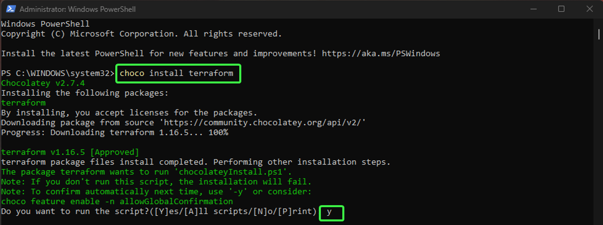
  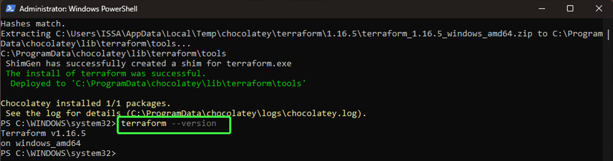

  ### 3. VS Code Erweiterung einrichten
  Installation der offiziellen **HashiCorp Terraform** Erweiterung für Syntax-Highlighting und Autovervollständigung:

  

  ### 4. Einrichtung des WSL Ubuntu Control Nodes
  Um Ansible unter Windows zu nutzen, richten wir das Windows Subsystem for Linux (WSL) ein:

  1. **WSL installieren:** Öffne die PowerShell als Administrator und führe folgenden Befehl aus:
   ```powershell
   wsl --install
   ```
  2. **Neustart:** Starte den Windows-PC neu.
  3. **Ersteinrichtung:** Nach dem Neustart öffnet sich die Ubuntu-Konsole. Vergib hier deinen Wunschnamen (`Username`) und ein neues Passwort (wird für `sudo`-Rechte verwendet).
  4. **System aktualisieren:**
   ```bash
   sudo apt update && sudo apt upgrade -y
   ```

  ### 5. Ansible-Installation via PPA
  Für die aktuellste Ansible-Version fügen wir das offizielle PPA-Repository hinzu und installieren das Paket:

  ```bash
  # Software-Properties installieren
  sudo apt install software-properties-common -y

  # Ansible PPA-Repository hinzufügen
  sudo add-apt-repository --yes --update ppa:ansible/ansible

  # Ansible installieren
  sudo apt install ansible -y
  ```

  ### Verifikation der Installation
  Überprüfe anschließend die installierte Ansible- und Ubuntu-Version:

  ```bash
  # Ansible Version prüfen
  ansible --version

  # Ubuntu OS Release prüfen
  cat /etc/os-release
  ```
  
</details>

## 02 | Provisionierung: Erstellung der Proxmox-Basistemplates für VMs sowie der LXC-Vorlagen

Vor der eigentlichen Automatisierung mit Terraform haben wir die grundlegenden Basistemplates und Container-Vorlagen direkt auf dem Proxmox VE Server eingerichtet.

### 💡 Erklärter Ablauf der Template-Erstellung:

1. **SSH-Schlüsselpaar & PowerShell-Verbindung:** Zuerst wurde lokal ein SSH-Schlüssel generiert (`ssh-keygen`) und der öffentliche Schlüssel (`.pub`) direkt über die Proxmox-Konsole hinterlegt. Dadurch konnten wir uns bequem und sicher vom lokalen Windows-PC via PowerShell per SSH mit dem Proxmox-Server verbinden, um die Skripte für die Templates direkt auf das System zu übertragen.
2. **Skript-Dateien anlegen:** Auf dem Server wurden mittels `nano ubuntu.sh` und `nano centos.sh` zwei leere Bash-Dateien erstellt.
3. **Template-Skripte befüllen:** In die Dateien wurden die Automationsskripte eingefügt – das **Ubuntu 22.04 Cloud-Init Template (VM 9000)** sowie das **CentOS Stream 9 Template (VM 9001)**.
4. **Rechte vergeben & Skripte ausführen:** Mit `chmod +x ubuntu.sh centos.sh` wurden beide Dateien ausführbar gemacht. Anschließend wurden die Skripte (`./ubuntu.sh` und `./centos.sh`) gestartet, um die jeweiligen Cloud-Images herunterzuladen, als SCSI-Disks einzubinden und in fertige Vorlagen umwandeln.
5. **Ergebnis der VM-Templates:** Am Ende standen beide Cloud-Init-Templates bereit auf Proxmox für das spätere Klonen via Terraform.
6. **LXC Container-Templates:** Für unsere Lightweight-Container wurde zusätzlich das Standard-Template `ubuntu-22.04-standard` über die Proxmox-GUI unter *CT Templates* heruntergeladen und die Hardware-Einstellungen überprüft.

### 🌟 3. Ubuntu 22.04 Cloud-Init Template Skript (`VM 9000`)
Inhalt des Automationsskripts zur Erstellung der Ubuntu-Vorlage:

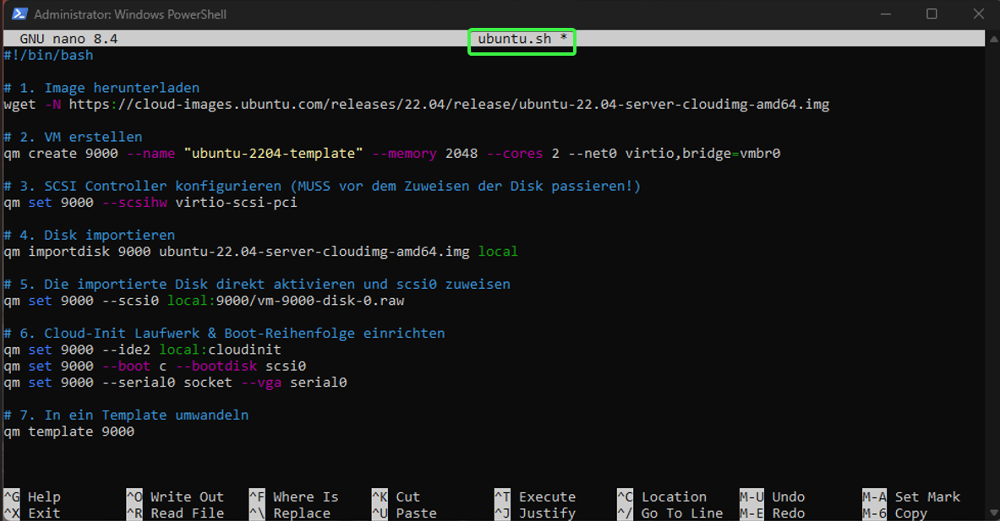

### 🌟 6. LXC Container-Templates über die Proxmox-GUI
Herunterladen der `ubuntu-22.04-standard` Vorlage unter *CT Templates* für unsere beiden Container:

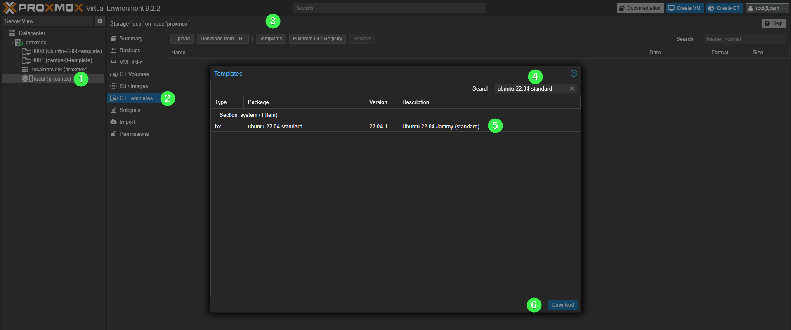

<details>
  <summary><b>▶️ Ausklappen: Alle Schritte mit Befehlen & Detail-Screenshots</b></summary>
  <br>

  #### 1. SSH-Verbindung von Windows PowerShell zu Proxmox
  Herstellen der Verbindung vom Windows-Host mithilfe des hinterlegten SSH-Keys:
  ```bash
  ssh root@<PROXMOX_IP>
  ```
  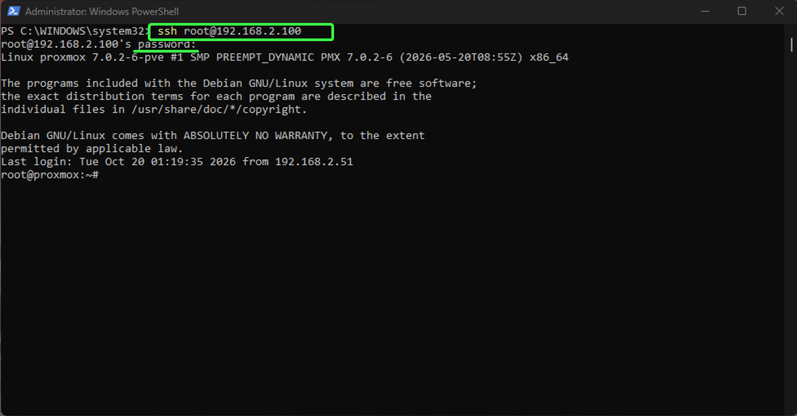

  #### 2. Shell-Skripte vorbereiten (`ubuntu.sh` & `centos.sh`)
  Erstellen und Ausführbar-Machen der Dateien auf dem Proxmox-Server:
  ```bash
  nano ubuntu.sh
  nano centos.sh
  chmod +x ubuntu.sh centos.sh
  ```
  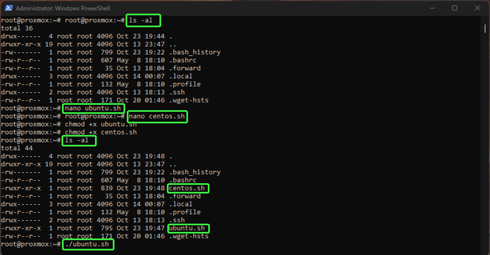

  #### 3. CentOS Stream 9 Template Skript (`VM 9001`)
  Inhalt des Skripts für die CentOS-Vorlage:

  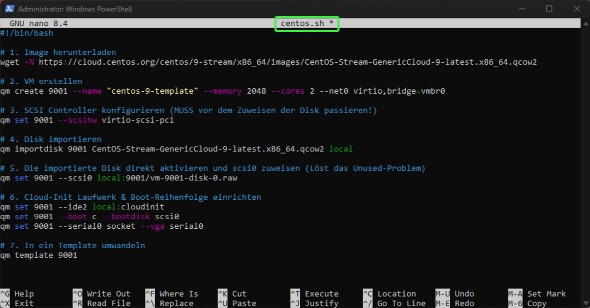

  #### 4. Ausführung der Skripte
  Starten des Skripts zur automatisierten Vorbereitung:
  ```bash
  ./centos.sh
  ./ubuntu.sh
  ```
  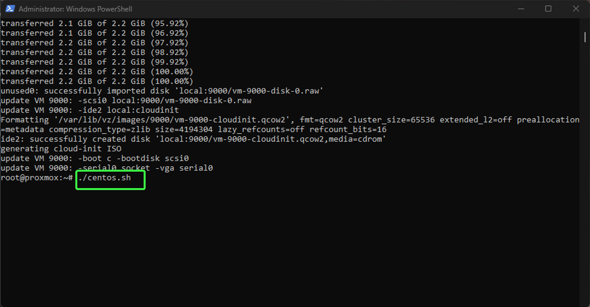

  #### 5. Fertige Templates im Proxmox-Dashboard
  Überprüfung der erstellten Templates (`VM 9000` & `VM 9001`) und deren Hardware-Einstellungen direkt im Proxmox-Webinterface:
  
  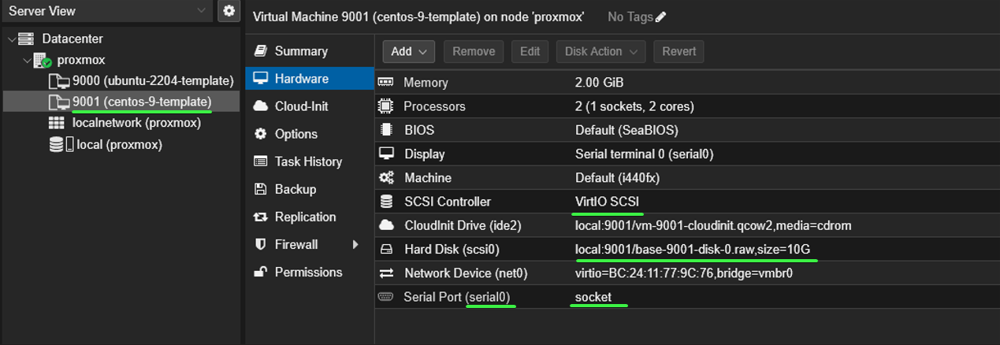

</details>

## 03 | Orchestrierung: Automatisierte Infrastruktur-Bereitstellung via Terraform

In diesem Schritt wird die komplette Ziel-Infrastruktur (2 VMs und 2 LXC-Container) vollautomatisiert über Terraform auf dem Proxmox-Server bereitgestellt.

### 💡 1. Proxmox API-Token & Authentifizierung einrichten

Für eine sichere Kommunikation zwischen Terraform und Proxmox ohne Passwort nutzen wir API-Tokens:
1. Im Proxmox-Webinterface navigieren wir zu **Datacenter ➔ API Tokens ➔ Add**.
2. **User wählen:** z. B. `root@pam` (oder einen anderen administrativen Nutzer wie `admin` bzw. `issa`).
3. **Token ID angeben:** `terraform-token`.
4. **Wichtig:** Option *Privilege Separation* **deaktivieren** (Haken entfernen), damit der Token die vollen Rechte des Nutzers erbt.
5. **Token Secret kopieren:** Nach dem Erstellen werden `Token ID` und `Secret Value` angezeigt. 

> ⚠️ **Achtung:** Das Token Secret wird nur ein einziges Mal angezeigt! Kopiere es sofort sicher.

Trage das Token und deinen öffentlichen SSH-Schlüssel anschließend in die Datei `terraform/terraform.tfvars` ein:

```hcl
proxmox_api_token = "DEIN_TOKEN_HIER"
ssh_public_key    = "DEIN_SSH_PUBLIC_KEY_HIER"
```

### 🌟 3. Erfolgreicher Ausführungsplan & Deployment (`terraform apply`)

Nach der Validierung wird der Infrastruktur-Plan ausgeführt. Die Bestätigung zeigt alle erfolgreich erzeugten Instanzen und deren zugewiesene IP-Adressen:


> 💡 **Best Practice: Timeouts & Locks bei Proxmox vermeiden**  
> Wenn Terraform mehrere Proxmox-Container zeitgleich anlegt oder startet, blockieren sich die parallelen API-Befehle durch Datei-Sperren (*PVE cluster file lock*) auf dem Server. Verwende daher den Befehl:
> ```bash
> terraform apply -parallelism=1
> ```
> Dies erzwingt eine sequenzielle Verarbeitung nacheinander, verhindert Konflikte und sorgt für ein fehlerfreies Deployment.

### 🌟 5. Proxmox Gesamtdashboard nach dem Deployment

Abschließende Übersicht im Proxmox-Webinterface mit allen 4 laufenden Instanzen (CentOS VM, Ubuntu VM, Prometheus LXC, Grafana LXC):

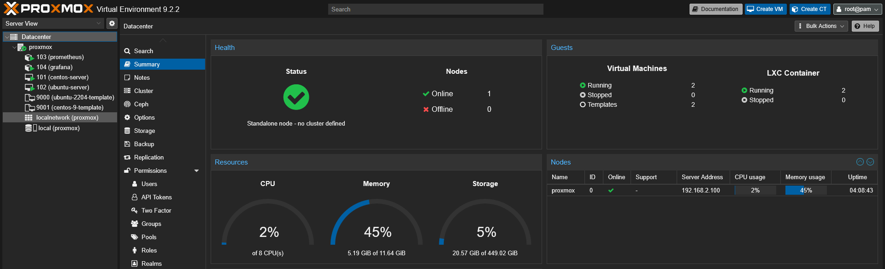

<details>
  <summary><b>▶️ Ausklappen: Terraform Workflow-Schritte & Verifikation</b></summary>
  <br>

  #### 1. Wechsel in das Terraform-Verzeichnis & Initialisierung
  Vor jedem Befehl wechseln wir in den Ordner `terraform/` und laden die Provider-Plugins (`bpg/proxmox`) herunter:
  ```bash
  cd terraform
  terraform init
  ```
  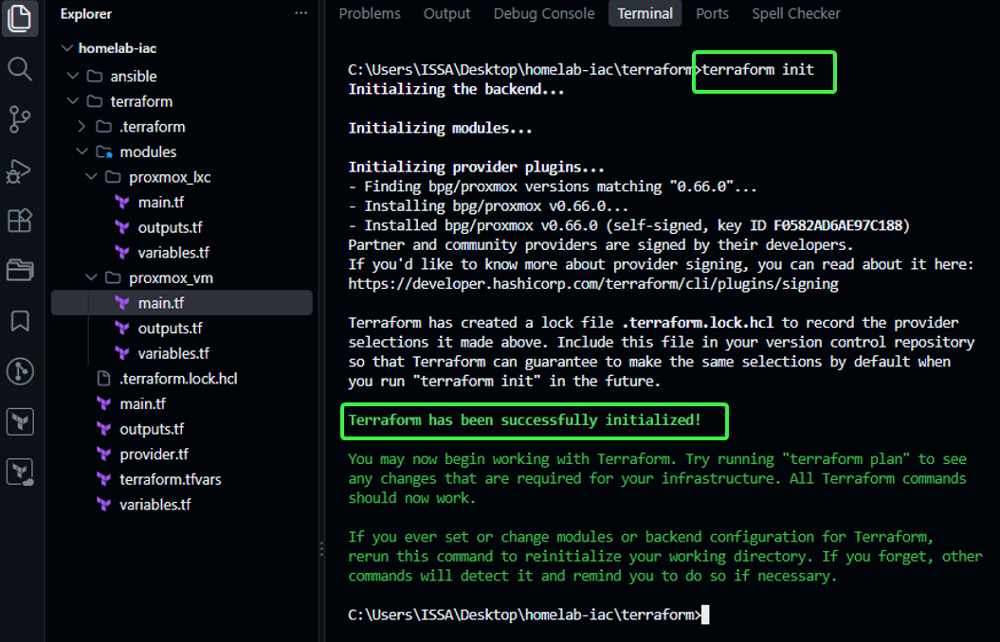

  #### 2. Terraform Ausführungsplan prüfen (`terraform plan`)
  Der Befehl `terraform plan` simuliert die Erstellung und zeigt alle geplanten Ressourcen an, ohne reale Änderungen vorzunehmen:
  ```bash
  terraform plan
  ```
  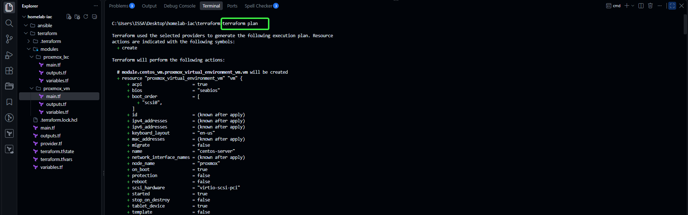

  #### 3. Ausführung der Provisionierung
  Starten der tatsächlichen Erstellung auf dem Proxmox-Server:
  ```bash
  terraform apply -parallelism=1
  ```
  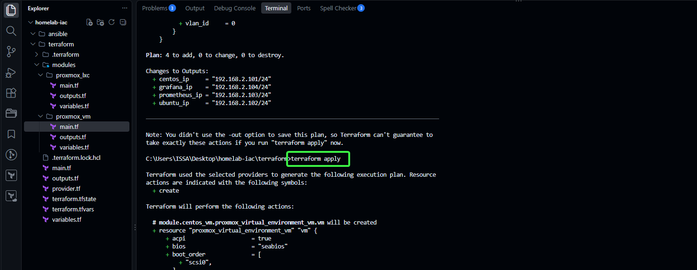

  #### 4. Verifikation nach dem Deployment (SSH- & Konsolen-Zugriff)

  * **SSH-Zugriff auf CentOS Stream 9 VM:**

    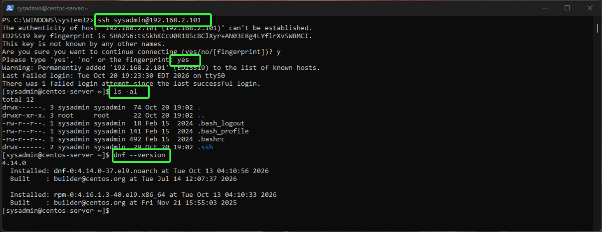

  * **SSH-Zugriff auf Ubuntu 22.04 VM:**

    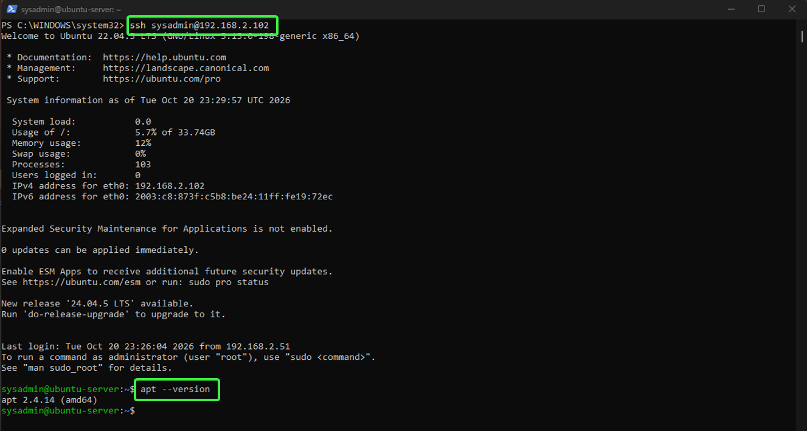

  * **Prometheus LXC-Container Konsole im Proxmox-Webinterface:**

    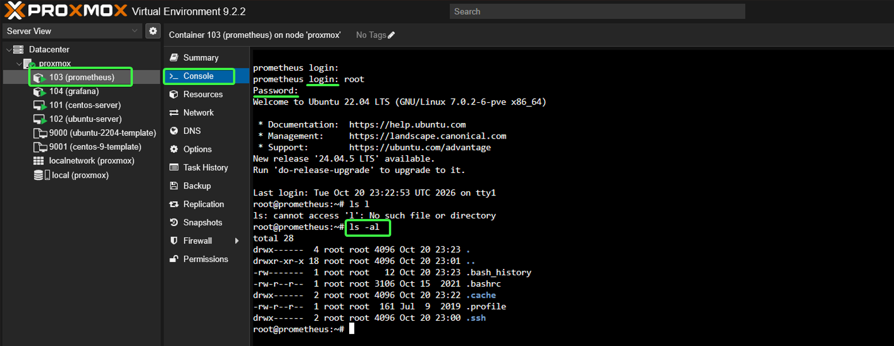

  * **Grafana LXC-Container Konsole im Proxmox-Webinterface:**

    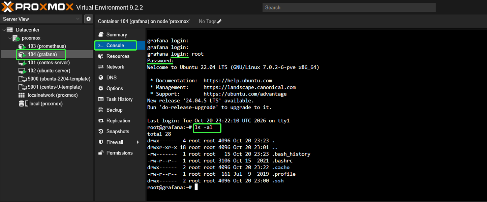

</details>

## 04 | Konfiguration: Deklaratives Konfigurationsmanagement mit Ansible

Um die Zielserver nach der Terraform-Bereitstellung vollautomatisiert konfigurieren und absichern zu können, richten wir die Ansible-Umgebung im WSL-System ein.

### 💡 Ablauf der Konfiguration:

1. **SSH-Schlüssel importieren und Rechte setzen:**
   Damit sich der WSL Control Node fehlerfrei und passwortlos mit den Managed Nodes verbinden kann, müssen die SSH-Schlüssel importiert und mit den korrekten Berechtigungen versehen werden:
   ```bash
   # SSH-Verzeichnis erstellen
   mkdir -p ~/.ssh

   # Schlüssel vom Windows-Desktop ins WSL kopieren
   cp /mnt/c/Users/ISSA/Desktop/homelab-iac/ansible/id_ed25519* ~/.ssh/

   # Sicherheitsrechte für SSH anpassen (wichtig, da SSH offene Rechte verweigert!)
   chmod 700 ~/.ssh && chmod 600 ~/.ssh/*
   ```

2. **Verbindung zu den Managed Nodes prüfen:**
   Die Testverbindungen zeigen, dass die passwortlose Authentifizierung über den SSH-Schlüssel einwandfrei funktioniert:
   * **Host 1 (`192.168.2.101`):** Ein **CentOS Stream 9** System (Paketmanager: `dnf`). Login als Benutzer `sysadmin` erfolgreich.
   * **Host 2 (`192.168.2.102`):** Ein **Ubuntu 22.04** System. Login als Benutzer `sysadmin` erfolgreich.

3. **Ansible-Ordner nach WSL kopieren:**
   Um Performance- und Rechteprobleme mit dem Windows-Dateisystem (NTFS) zu umgehen, kopieren wir das Ansible-Projektverzeichnis direkt in das lokale WSL-Dateisystem:
   ```bash
   cp -r /mnt/c/Users/ISSA/Desktop/"Infrastructure as Code mit Terraform & Ansible"/ansible ~/ansible
   cd ~/ansible
   ```

4. **Ansible Inventory Ping-Test:**
   Überprüfung der Erreichbarkeit aller im Inventory definierten Hosts über das Ansible-Ping-Modul:
   ```bash
   ansible all -m ping
   ```

5. **Erfolgreicher Playbook-Durchlauf (Play Recap):**
   Nach erfolgreichem Test führen wir zuerst einen Syntax-Check durch und starten anschließend das Haupt-Playbook für die vollständige Systemkonfiguration:
   ```bash
   # Syntax-Check des Playbooks durchführen
   ansible-playbook -i inventory.ini site.yml --syntax-check

   # Haupt-Playbook ausführen
   ansible-playbook site.yml
   ```

### 🌟 5. Erfolgreicher Playbook-Durchlauf (Play Recap)

Ergebnis der vollständigen Systemkonfiguration und Absicherung über alle Instanzen hinweg:

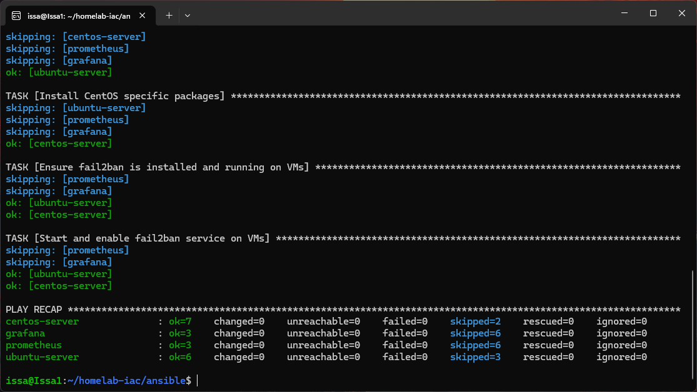

<details>
  <summary><b>▶️ Ausklappen: SSH-Verbindungsprüfung & Ping-Test Screenshots</b></summary>
  <br>

  #### 2. Verbindung zu den Managed Nodes prüfen
  Manuelle Überprüfung der SSH-Erreichbarkeit der beiden VMs:

  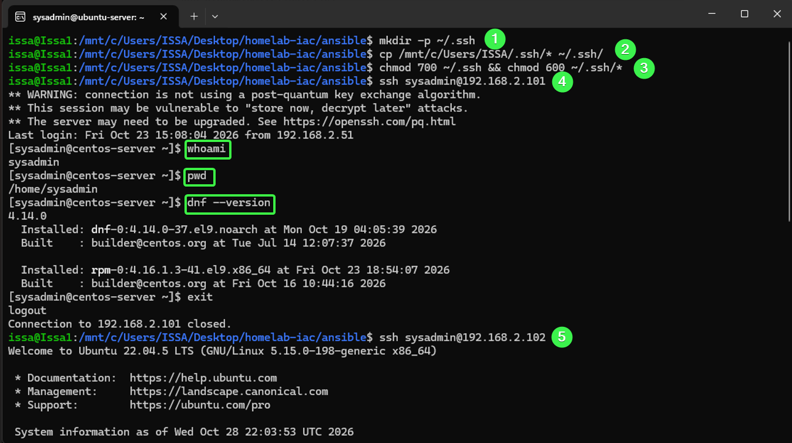

  #### 4. Ansible Inventory Ping-Test
  Erfolgreicher Ping-Test aller Managed Nodes über Ansible:

  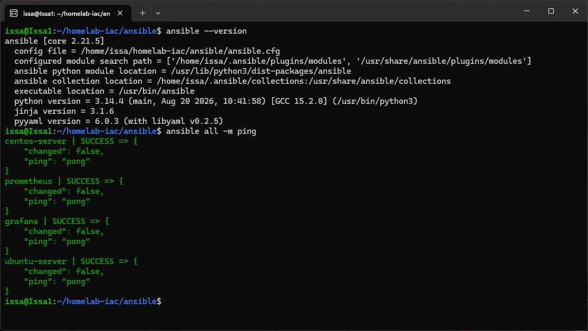

</details>

## 🧹 Abbau & Bereinigung (Teardown)

Falls die Infrastruktur zurückgesetzt, gelöscht oder die gesamte Entwicklungsumgebung vom PC entfernt werden soll, stehen zwei Wege zur Verfügung:

<details>
  <summary><b>▶️ Ausklappen: Option A – Nur die Infrastruktur & das Projekt löschen (Empfohlen)</b></summary>
  <br>

  > **Anwendungsfall:** Verwenden Sie diese Option, wenn Sie die Proxmox-Ressourcen freigeben, aber das WSL-Ubuntu und Ansible für zukünftige Projekte behalten möchten.

  1. **Infrastruktur auf Proxmox zerstören (Windows PowerShell oder WSL):**
     ```bash
     cd terraform
     terraform destroy
     ```

  2. **Lokale Terraform-State-Dateien auf dem Windows-Host bereinigen (Windows CMD):**
     ```cmd
     del /f /q terraform.tfstate terraform.tfstate.backup .terraform.lock.hcl && rmdir /s /q .terraform
     ```

  3. **Ansible-Projektordner im WSL löschen (WSL Ubuntu):**
     ```bash
     rm -rf ~/ansible
     ```

</details>

<details>
  <summary><b>▶️ Ausklappen: Option B – Vollständige Bereinigung (Projekt, WSL, Ansible & Terraform löschen)</b></summary>
  <br>

  > ⚠️ **Wichtiger Hinweis:** Führen Sie unbedingt zuerst `terraform destroy` aus **Option A** durch, bevor Sie die Tools deinstallieren. Andernfalls können die erstellten VMs/LXC-Container auf Proxmox nicht mehr automatisch abgebaut werden!

  1. **Ubuntu-Distribution & Ansible löschen (Windows PowerShell):**
     Da Ansible innerhalb der WSL-Ubuntu-Umgebung installiert ist, wird es durch das De-Registrieren der Distribution automatisch mit entfernt.

     ```powershell
     # Installierte Distributionen anzeigen
     wsl --list

     # Ubuntu-Instanz vollständig löschen
     wsl --unregister Ubuntu
     ```
     *(Hinweis: Ersetzen Sie `"Ubuntu"` durch den exakten Namen aus der Liste, z. B. `"Ubuntu-22.04"`).*

  2. **Terraform deinstallieren (Windows PowerShell als Administrator):**
     ```powershell
     choco uninstall terraform -y
     ```

  3. **WSL-Feature in Windows deaktivieren (Optional / Windows PowerShell als Admin):**
     Falls WSL auf dem System nicht mehr benötigt wird:
     ```powershell
     Disable-WindowsOptionalFeature -Online -FeatureName VirtualMachinePlatform, Microsoft-Windows-Subsystem-Linux -NoRestart
     ```

  4. **Projektordner auf Windows löschen:**
     Löschen Sie abschließend den Hauptordner (`Infrastructure as Code mit Terraform & Ansible`) von Ihrem System, um alle verbleibenden lokalen Konfigurationsdateien zu entfernen.

</details>

## 🎯 Nächste Schritte & Ausblick

Damit ist die automatisierte Infrastruktur-Provisionierung und Konfiguration unseres Proxmox-Homelabs im **Teil 2** erfolgreich abgeschlossen! 

Alle virtuellen Maschinen und LXC-Container wurden via **Terraform** strukturiert bereitgestellt und anschließend durch **Ansible** vollautomatisch konfiguriert und gehärtet.

In **Teil 3** werden wir uns intensiv mit dem **Monitoring & Observability Stack** beschäftigen:
- **Prometheus** zur Metrik-Erfassung der Proxmox-Knoten, VMs und LXC-Container.
- **Grafana** zur Visualisierung von Performance-Daten über maßgeschneiderte Dashboards.
- Automatisierte Log-Aggregation und Alerting für kritische Systemzustände.

_Dokumentiert und umgesetzt von **Mohamad Issa**_